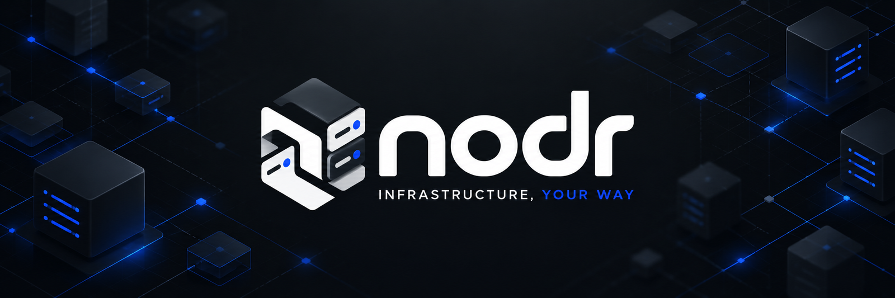
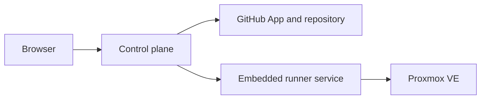

<p align="center">
  
</p>

nodr is a self-hosted control plane for Proxmox VE infrastructure. Install it
on a dedicated VPS: administrators use the browser, while automation uses the
HTTP API. A GitHub repository is the desired-state ledger; nodr turns intent
and managed OpenTofu code into reviewable Git commits.

> **Migration status.** The currently shipped local-workspace CLI commands and
> their setup instructions are legacy implementation paths. They remain while
> the hosted web replacement is built, but are not the product contract or a
> prerequisite for deployment.

## M0 hosted workflow

1. Deploy the nodr control-plane and runner services on one dedicated VPS.
2. Supply the bootstrap token, KEK, GitHub App credentials, webhook secret and
   public URL as server configuration or mounted deployment secrets. Do not put
   them in Git or browser forms.
3. Open `https://<nodr-host>/setup`, enter the one-time bootstrap token, and
   create the first administrator in the browser.
4. Install the GitHub App for a repository containing `nodr.yaml`, then connect
   that installation from the browser.
5. Make changes in drafts, review the static diff and saved OpenTofu plan, then
   explicitly apply the reviewed draft.

The browser is the only administrator and end-user surface in M0. GitHub App
installation tokens and signed push webhooks are handled server-side. The API
remains the only supported automation interface; it follows the same draft,
commit, plan and apply rules as the UI.

## Deployment contract

M0 is one VPS instance with SQLite for operational state and local repository
mirrors. GitHub is the external forge integration. Git stores desired state;
SQLite stores operational records such as users, sessions, workspace metadata,
webhook delivery de-duplication, changesets, operations and artifacts. Losing
SQLite must not lose desired state, but it does lose operational history unless
it is restored from backup.

Deploy separate OCI services/images for the control plane and embedded runner.
The runner executes OpenTofu jobs in isolation and never exposes a user shell.
Its concrete local job protocol is an implementation gate, not a public M0
protocol claim. M0 does not provide Kubernetes, HA, OIDC, remote runners, Git
smart HTTP, or terminal CLI administration.

Webhook ingress requires the configured public HTTPS URL. GitHub push webhooks
are verified before processing and are idempotent by delivery ID. Without
working public webhook ingress, readiness must fail rather than silently
becoming a one-way UI-to-Git system.

## Repository layout

A connected repository contains `nodr.yaml`, YAML intent below `intent/`, and
generated OpenTofu code below `terraform/`:

```text
repository/
├── nodr.yaml
├── intent/
└── terraform/
```

UI commands create commits on draft refs, never directly on the default branch.
Each mutation carries the draft HEAD as `If-Match`; stale HEADs return `412
Precondition Failed`. Ref updates use compare-and-swap (CAS), so concurrent
writes cannot both win. A successful plan is tied to its exact commit SHA and
apply merges that reviewed draft once before the runner applies the saved plan.

GitHub pushes and UI writes enter the same synchronization pipeline. Literal
edits can lift into intent; expressions and other code-owned fields remain
editable only in code. The pipeline preserves unmanaged code and comments,
commits synchronization results to the relevant draft, and exposes conflicts
for review instead of overwriting either representation.

## Features

- **Browser-managed bootstrap** using a one-time server-supplied token.
- **GitHub App repository connection** with server-held installation tokens and
  signed, idempotent webhook processing.
- **Git-backed drafts and review** with CAS-protected repository refs.
- **YAML intent and structure-preserving OpenTofu synchronization** for current
  Proxmox VM capabilities.
- **Saved-plan execution** through the isolated runner after explicit review.
- **Authenticated HTTP API** for automation, using the same repository rules.

## How it works



## Status and roadmap

nodr is pre-1.0. The hosted M0 contract is intentionally limited to Git-backed
Proxmox VM management on one VPS. See the
[delivery roadmap](docs/design/13-operations-and-delivery.md#138-delivery-roadmap)
for later milestones and the [technical design](docs/README.md) for details.

## Documentation

- [Technical design](docs/README.md): architecture, repository sync, security,
  API and operations.
- [Architecture decision records](docs/adr/README.md): product decisions.
- [Homelab example](examples/homelab/README.md): repository layout reference.
- [Changelog](CHANGELOG.md): notable released and unreleased changes.

## Contributing

[CONTRIBUTING.md](CONTRIBUTING.md) covers development setup, tests, Git
conventions, and releases.

## License

nodr is licensed under the Apache License 2.0; see [LICENSE](LICENSE).
