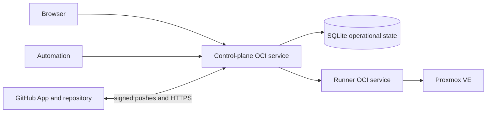

# 2. System Architecture

> Part of the [nodr technical design](../README.md).

## 2.1 M0 architecture

M0 is a single self-hosted VPS control plane. A browser is the human
administration surface; the HTTP API is retained for automation. A GitHub App
is the only external forge integration. GitHub repositories are the
desired-state ledger, while SQLite stores operational state for this one VPS.

The control plane and runner are separate OCI images/services. The runner
executes OpenTofu in an isolated job environment. The concrete internal local
job interface between them is not yet an established protocol; implementing it
is a delivery gate, not a claim of in-process execution, gRPC, mTLS, or remote
runner support.

> **Implementation status.** The shipped ledger runs OpenTofu in-process on the
> control-plane host through `ledger.LocalRunner` behind the `ledger.Runner`
> interface. The separate runner service above is the target topology and is not
> implemented. Saved plans are retained in memory by `LocalRunner`, so they do
> not survive a restart; apply then reports `409 PLAN_CHANGED` and the user
> plans again. Promotion of the default branch is skipped when the plan is no
> longer retained.

M0 excludes HA, PostgreSQL, OIDC, Kubernetes, remote runners, Git smart HTTP,
and non-GitHub forge integrations.

## 2.2 Repository and consistency model

The repository service owns a bare mirror per workspace and creates a
short-lived checked-out worktree per operation. It never exposes one mutable
process-wide workspace directory. A workspace's metadata—GitHub installation
and repository identity, default branch, encrypted webhook secret, and last
processed remote SHA—lives in SQLite, not Git.

1. Git refs are the desired-state durability and linearization point. A UI
   write commits to a draft ref and advances it with CAS.
2. Requests carry the expected draft HEAD as `If-Match`; a mismatch is `412
   Precondition Failed`. The ETag is the relevant commit SHA.
3. UI writes and verified GitHub pushes enter the same sync pipeline. Pushes
   are accepted only for the configured default branch or `nodr/drafts/` refs,
   are deduplicated by persisted GitHub delivery ID, and update the processed
   SHA only after sync or a committed conflict draft.
4. A default-branch push creates a server-owned sync draft rather than mutating
   the branch. Sync results for draft pushes remain on that draft.
5. SQLite is authoritative for operations, sessions, changesets, webhook
   de-duplication and artifacts, but losing it cannot lose desired state.

## 2.3 M0 request and execution flow

1. Deployment supplies a bootstrap token, KEK, GitHub App credentials, webhook
   secret and public URL to the server. `/setup` consumes the token once to
   create the first administrator.
2. The administrator connects an accessible GitHub App repository containing
   `nodr.yaml` in the browser. Installation tokens remain server-side.
3. A typed UI/API command checks out its draft, validates and synchronizes the
   change, commits `nodr: <actor> <command>`, and CAS-updates the draft ref.
4. Planning records a saved plan against the exact draft SHA. Apply rejects an
   outdated plan, CAS-merges the reviewed draft once, then asks the runner to
   apply that saved plan.
5. The runner returns progress through durable operations and SSE. A lost
   browser session never cancels server-owned execution.

## 2.4 Data architecture

| Data | Store | Authority |
| ---- | ----- | --------- |
| Intent, generated OpenTofu, render lock and pristine refs | GitHub repository/mirror | Desired state |
| Workspace metadata, users, sessions, deliveries, changesets, operations | SQLite under VPS data directory | Operational state |
| Proxmox and integration credentials | Envelope-encrypted server data | Secret material |
| Plans and logs | Server data directory keyed by operation | Operational artifacts |

Plaintext bootstrap tokens, GitHub private keys and installation tokens,
Proxmox credentials, and KEKs never enter Git.
